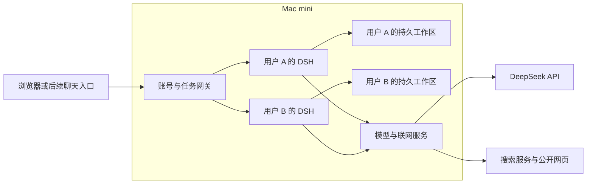

# Mac mini 托管 DSH Bot

状态：设计草案。先试用现有版本一段时间，记录遇到的文件权限、脚本、联网和长任务问题，之后再根据实际需求确定第一期开发范围。

目标体验：每位用户打开同一个网址，登录后看到自己的 DSH。可以上传和整理文件、运行工作脚本、搜索和读取网页，在手机和电脑间继续同一任务。账号、会话、个人 Skill 和工作文件保存在 Mac mini 上，普通用户无需在自己的设备安装 DSH 或 Docker。第一批使用者通过现有的 Tailscale 私有入口访问。

## 现有基础

原版 DSH Web、账户管理和每账号独立容器已经存在。容器按需启动，空闲后回收，文件和会话在宿主机数据目录持久保存。Tailscale 负责让浏览器访问 Mac 上的网页；普通 DSH 回复通过 Mac 上的模型代理访问 DeepSeek。当前最多同时两个活跃实例；扩大使用人数前，在目标 Mac mini 上测量内存、冷启动和并发。

现版管理权限只涉及账户、知识库和 Skill。DSH 的工具清单没有 Shell 和网页访问，运行容器不接公网，文件工具只在个人工作区写入；授权共享资料只读。适合继续用作基础版，也适合作为托管版的回退模式。

## 托管版第一期

1. **独立工作区和脚本能力。** 保留非 root、只读系统镜像，为每个账号提供可写工作区和临时目录。给测试账号增加独立的脚本执行工具，预装 Python、Node、Shell 及实际使用的文档依赖。脚本只拿到本人工作区和获授权的只读资料；脚本进程与 DSH 的内部接口、状态和凭据分开。脚本依赖先随镜像提供，验证实际需要后再设计可持久化的用户依赖目录。
2. **受控搜索和读网页。** 在 DSH 工具中加入「搜索网页」「打开网页」，由 Mac mini 上的服务发起请求。读取公开 HTTP(S) 地址并返回带来源的内容；每次重定向重新检查目标，避免访问 Mac mini、局域网、Tailnet 和其他账户的服务。先支持搜索、网页和下载，再评估哪些任务需要浏览器或命令行网络。能用 DeepSeek 对话与能搜索互联网是两条独立的通道。
3. **后台任务和恢复。** 已经被网关接受的 DSH 轮次不依赖浏览器保持连接。下一步记录每项任务的执行状态和停止原因，让换设备后能看到运行中、已完成、超时或可重试。服务重启后可找回历史与产物；自动从中断点恢复需要工具操作可重放，第一期用明确的中断状态和手动继续。
4. **常驻运行。** 在目标 Mac mini 配置服务常驻、持久数据、备份及重启检查。继续用现有账户管理开通用户，并按账户启用新能力。先验收浏览器入口；未来需要聊天平台 Bot 时，复用同一网关和账号绑定。

## 隔离方式与验收

小规模受邀团队可以先复用当前每账号容器。若要开放给陌生用户，或允许任意安装程序、长时间运行服务及自由出网，应先验证独立 Linux 虚拟机等更强的隔离和资源成本。默认文件和历史保存在 Mac mini；请求云模型时，生成回答所需的消息、附件内容和工具结果仍可能发给 DeepSeek，搜索词会发给搜索提供方。如果要求内容完全不出设备，需要另外验证本地模型与本地检索。

首轮用两个合成账户验证：分别创建和运行脚本；读取公网网页并获得来源；尝试访问其他账号目录、宿主机和私网服务并被拒绝；完成超过 12 次模型请求的任务；关浏览器后重新登录看到结果；重启服务后文件与历史仍在。通过后再用真实办公任务和目标 Mac mini 的实际并发做小范围试用。
